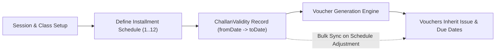
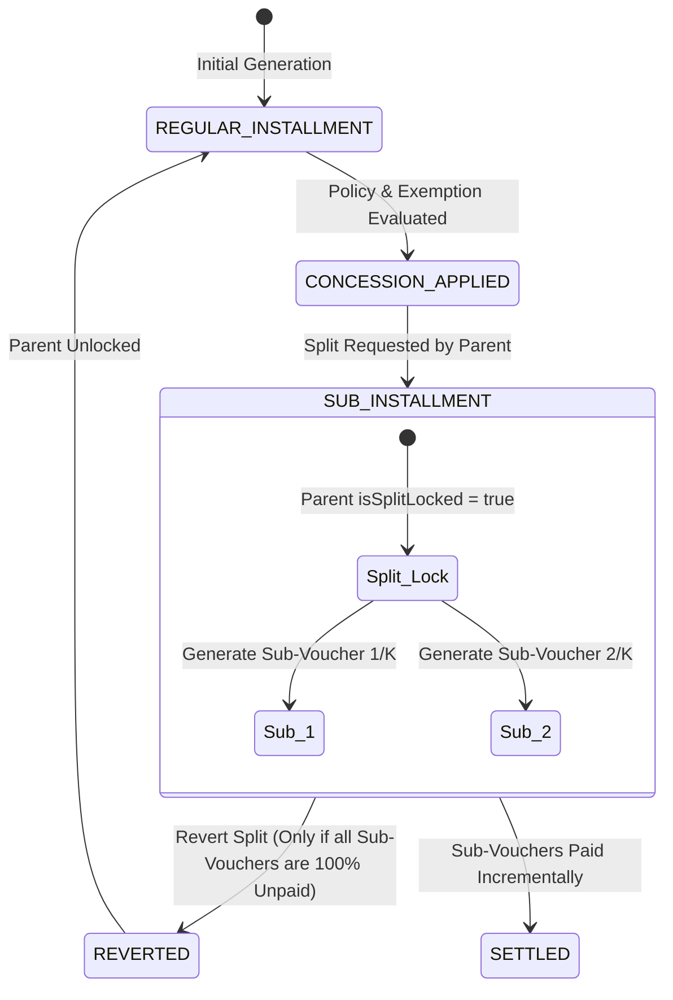

# Enterprise Fee Management & Monthly Voucher System — Architecture Walkthrough & Implementation Plan

## Executive Summary

This walkthrough details the enterprise upgrade to the **MSNS LMS/ERP Fee Management System**, bridging the six operational and architectural gaps identified:
1. **Challan Validity Windows (`ChallanValidity`)**: Eliminates ad-hoc due dates via non-overlapping installment schedules per session/class with bulk-sync capabilities.
2. **Concession vs. Exemption Separation**: Unbundles policy/merit-based concessions (linked to $\ge 80\%$ attendance auto-continuation) from one-off Principal discretionary exemptions.
3. **Sub-Installment (Voucher Splitting) State Machine**: Implements parent-child voucher hierarchies with strict sequence locking (`Concession Apply` $\rightarrow$ `Split` $\rightarrow$ `Revert if Unpaid`).
4. **Full-Session / Multi-Month Merged Challan**: Consolidates consecutive unpaid months into a single unified barcode voucher (`FULL_YEAR_MERGED`) with cascading settlement.
5. **Operational Payment Safeguards**: Hardens payment confirmations against race conditions and double-payments, capturing user identity, collecting bank, and ledger integration.
6. **Protected Class Transfer & Promotion**: Replaces destructive deletions in `allotment.ts` and `promotion.ts` with automated fee differential adjustments (`FEE_ADJUSTMENT`) and unpaid-arrears clearance guardrails.

---

## 1. Deep Dive: Solving the 6 Operational Gaps

### Gap 1: Strict Challan Validity Window (`ChallanValidity`)

#### Problem
Due dates are historically set ad-hoc per voucher record, leading to mismatched payment deadlines across students in the same class, arbitrary late-fee calculations, and no systematic scheduling for 12 monthly installments or 3 term installments.

#### Architectural Solution
- Introduce the **`ChallanValidity`** table that acts as the single source of truth for fee validity windows.
- Define a temporal non-overlapping rule enforced at both the database level (`@@unique([sessionId, gradeId, installmentNo])`) and application service layer:
  $$\text{For any class } C \text{ and installment } k: \quad \text{fromDate}_k \le \text{toDate}_k < \text{fromDate}_{k+1}$$
- **Bulk Sync Engine (`syncChallanValidityToVouchers`)**:
  When an administrator updates a validity window (e.g. extending a due date due to unforeseen holidays), the system propagates the new `issueDate` and `dueDate` to all open (`PENDING`, `PARTIALLY_PAID`) vouchers for that class and installment in an atomic batch query, preventing manual per-record edits.



---

### Gap 2: Concession vs. Exemption Formal Separation

#### Problem
`FeeStudentClass` historically stored only `discount` and `discountByPercent`, blending policy-driven institutional scholarships (which are performance-contingent) with one-off compassionate fee waivers granted by the Principal.

#### Architectural Solution
We formally partition financial reductions into two distinct models and audit tracks:
1. **Category Concessions (`concessionCategory`, `concessionScope`, `concessionAmount`)**:
   - Institutional, rules-based discounts: `RS_10_SCHOLARSHIP`, `A_PLUS_PLUS` ($90\%+$ Merit), `A_PLUS` ($85\%+$ Merit), `A_GRADE` ($80\%+$ Merit), `B_PLUS`, `B_GRADE`, `C_PLUS`, `C_GRADE`, `D_PLUS`, `D_GRADE`, `SIBLING_CONCESSION`, `STAFF_CHILD`, `ORPHAN_WELFARE`.
   - **Attendance Auto-Continuation Rule**: For all merit and welfare concessions spanning multiple installments (`GENERAL_ONE_YEAR`, `SPECIAL_TWO_YEAR`), an automated pre-generation worker calculates the student's attendance in `StudentAttendance` for the preceding month:
     $$\text{Attendance Rate} = \frac{\text{Count}(\text{Status} \in \{'P', 'L'\})}{\text{Total School Days}} \times 100\%$$
     If $\text{Attendance Rate} < 80\%$, the policy concession is automatically marked **`SUSPENDED_LOW_ATTENDANCE`**, and the student is billed the standard tuition.
2. **Principal Discretionary Exemptions (`exemptionAmount`, `exemptionApprovedBy`, `exemptionReason`)**:
   - One-off discretionary waivers approved strictly by `managementProcedure` (Admin or Principal).
   - Mandatory reason string and approval employee ID captured in audit logs.
3. **Backward Compatibility**:
   $$\text{discount} = \text{concessionAmount} + \text{exemptionAmount}$$
   Legacy reports and queries reading `discount` continue to function seamlessly without breaking schema consumers.

---

### Gap 3: Sub-Installment (Voucher Splitting) State Machine

#### Problem
Parents unable to afford a full monthly or term tuition in a single transaction frequently negotiate splitting the payment into 2 or 3 smaller installments. Clerks previously hacked this by manually altering amounts or recording partial payments, leaving the accounting ledger inconsistent.

#### Architectural Solution
A formal parent-child voucher hierarchy using `parentVoucherId`, `subInstallmentIndex`, and `isSplitLocked`.



#### State Machine Rules:
1. **Concession First**: Concessions and exemptions MUST be applied and finalized on the parent voucher *before* splitting. Net payable:
   $$\text{Net Payable} = \text{Base Fee} + \text{Arrears} - \text{Concession} - \text{Exemption} + \text{Fine}$$
2. **Deterministic Partitioning**:
   - A voucher with net payable $P$ split into $K$ installments creates child records with amounts:
     $$\text{Child Amount}_i = \lfloor P / K \rfloor \quad \text{for } 1 \le i < K, \quad \text{Child Amount}_K = P - \sum_{j=1}^{K-1} \text{Child Amount}_j$$
   - Each child gets an incrementing `subInstallmentIndex` ($1 \dots K$) and its own distinct due date.
3. **Sequence Lock & Revertibility**:
   - Parent record is set to `isSplitLocked = true`. It cannot be collected directly while split.
   - If the parent changes their mind, the split can be **reverted** if and only if **zero rupees have been collected** across all sub-installments:
     $$\forall i \in \{1 \dots K\}, \quad \text{child}_i.\text{amountPaid} = 0$$
   - As soon as child 1 receives any payment, the split is permanently locked.

---

### Gap 4: Full-Session / Multi-Month Merged Challan

#### Problem
When a student accumulates 2 to 6 months of unpaid fee installments, generating separate challans for each month results in multiple barcodes, confusion at the bank counter, and dropped late fees.

#### Architectural Solution
- Introduce `VoucherType.FULL_YEAR_MERGED`.
- **Consolidation Workflow**:
  1. Clerk selects a student and a set of consecutive unpaid vouchers $[V_1, V_2, \dots, V_m]$.
  2. The system calculates the aggregated breakdown:
     $$\text{Total Base} = \sum \text{baseFee}_i, \quad \text{Total Late Fees} = \sum \text{lateFee}_i, \quad \text{Total Concessions} = \sum \text{discount}_i$$
  3. A new master `FeeStudentClass` record is created with:
     - `voucherType = FULL_YEAR_MERGED`
     - Distinct sequential barcode/voucher number
     - Aggregate net payable
  4. Each constituent child voucher has `mergedIntoVoucherId` set to the new master voucher ID, and its status set to `LOCKED_MERGED`.
  5. When the consolidated challan is settled at the bank/counter, a single atomic transaction marks the master voucher as `PAID` and cascades `tuitionPaid = true`, `paymentStatus = PAID`, `paidAt = now()` across all child records, with audit cross-references.

---

### Gap 5: Operational Safeguards on Payment Confirmation

#### Problem
Cash-counter operators and bank import processes face concurrency hazards: double submission of payments, unrecorded collecting channel, missing operator identity, and discrepancy between fee receipts and general ledger accounts.

#### Architectural Solution
- **Idempotent Atomic Settlement**:
  All payment updates run inside an interactive Prisma transaction (`ctx.db.$transaction`) with an explicit payment status guard:
  ```typescript
  const existing = await tx.feeStudentClass.findUnique({ where: { sfcId } });
  if (existing.paymentStatus === PaymentStatus.PAID) {
    throw new TRPCError({ code: "BAD_REQUEST", message: "Voucher has already been settled in full." });
  }
  ```
- **Operator & Channel Audit Footprint**:
  Capture `confirmedByUserId` (authenticated session employee), `collectingBank` (e.g. `CASH_COUNTER`, `MEEZAN_BANK_LMS`, `BANK_ALFALAH`), `collectorName`, and exact `paidAt` timestamp.
- **Structured JSON Payment History Ledger**:
  `paymentHistory` array stores an immutable append-only event record for every transaction:
  ```json
  [
    {
      "transactionId": "tx_cuid...",
      "amount": 4500,
      "paymentMode": "CASH",
      "collectingBank": "CASH_COUNTER",
      "collectorName": "Tahir Clerk",
      "confirmedByUserId": "usr_cuid...",
      "receiptNumber": "REC-2026-0042",
      "timestamp": "2026-10-30T14:30:00Z"
    }
  ]
  ```
- **Automated ERP Financial Ledger Posting**:
  Payment triggers an automatic posting to `FinancialLedgerEntry`:
  - Debit: `Cash at Hand` / `Bank Account`
  - Credit: `Tuition Fee Revenue`
  - Credit: `Late Fee Fine Revenue`

---

### Gap 6: Protected Class Transfer & Promotion Guardrails

#### Problem
- In `allotment.ts` (lines 201-203), deleting student-class associations executes `tx.feeStudentClass.deleteMany`, directly wiping out historical fee transactions and receipts!
- Students transferred between grades mid-session (e.g., from Montessori at PKR 3,000 to Grade 1 at PKR 4,500) generate no differential billing.
- In `promotion.ts` (lines 83-90), students can be promoted across academic years even if they owe substantial unpaid arrears from the prior year.

#### Architectural Solution
1. **Eliminate Destructive Deletions in `allotment.ts`**:
   - Replace `deleteMany` with a validation check:
     ```typescript
     const paidVouchers = await tx.feeStudentClass.findFirst({
       where: { studentClassId: { in: studentClassIds }, paymentStatus: { in: [PaymentStatus.PAID, PaymentStatus.PARTIALLY_PAID] } },
     });
     if (paidVouchers) {
       throw new TRPCError({
         code: "PRECONDITION_FAILED",
         message: "Cannot remove student: Paid financial records exist. Mark student as transferred/withdrawn instead.",
       });
     }
     ```
2. **Automated Fee Differential Engine (`FEE_ADJUSTMENT`)**:
   - When a student is transferred to a different grade mid-session:
     $$\Delta \text{Tuition} = \text{Fee}_{\text{NewGrade}} - \text{Fee}_{\text{OldGrade}}$$
   - For all unbilled or remaining installments in the active session:
     - If $\Delta \text{Tuition} > 0$: Issue a differential `FEE_ADJUSTMENT` voucher for the remaining prorated months.
     - If $\Delta \text{Tuition} < 0$: Create an account credit adjustment note applied to subsequent vouchers.
3. **Promotion Clearance Guardrails (`promotion.ts`)**:
   - Introduce `verifyPromotionFeeClearance`:
     ```typescript
     const unpaidBalance = await tx.feeStudentClass.aggregate({
       where: {
         StudentClass: { studentId: input.studentId, sessionId: input.fromSessionId },
         paymentStatus: { in: [PaymentStatus.PENDING, PaymentStatus.PARTIALLY_PAID, PaymentStatus.OVERDUE] },
       },
       _sum: { amountPaid: true }, // against net calculated due
     });
     ```
   - If outstanding arrears exist, promotion is blocked unless an explicit `clearanceBypassCode` approved by Principal is supplied and logged.
   - Do NOT execute `studentClass.deleteMany` during promotion! Retain prior session `StudentClass` records for historical academic and accounting transcripts.

---

## 2. Database Schema Specification

### New Enums & Modified Models (`prisma/schema.prisma`)

```prisma
// ==========================================
// ENTERPRISE FEE WORKFLOW ENUMS
// ==========================================

enum VoucherType {
  REGULAR_INSTALLMENT
  SUB_INSTALLMENT
  FULL_YEAR_MERGED
  FEE_ADJUSTMENT
  FINE_CHALLAN
}

enum PaymentStatus {
  PENDING
  PARTIALLY_PAID
  PAID
  OVERDUE
  CANCELLED
}

enum ConcessionCategory {
  NONE
  RS_10_SCHOLARSHIP
  A_PLUS_PLUS // 90%+ Merit
  A_PLUS      // 85%+ Merit
  A_GRADE     // 80%+ Merit
  B_PLUS
  B_GRADE
  C_PLUS
  C_GRADE
  D_PLUS
  D_GRADE
  SIBLING_CONCESSION
  STAFF_CHILD
  ORPHAN_WELFARE
}

enum ConcessionScope {
  SPECIAL_TWO_YEAR
  GENERAL_ONE_YEAR
  REFERRAL_ONE_INSTALLMENT
}

enum FineNature {
  LATE_FEE
  DISCIPLINE
  ABSENTEEISM
  LIBRARY_DAMAGE
  LAB_BREAKAGE
  OTHER
}

// ==========================================
// 1. CHALLAN VALIDITY (NON-OVERLAPPING WINDOWS)
// ==========================================

model ChallanValidity {
  challanValidityId String   @id @default(cuid())
  sessionId         String
  gradeId           String   // Links to Grades (classId)
  installmentNo     Int      // 1..12 (Monthly) or 1..3 (Term)
  month             Int?     // Calendar month (1..12)
  year              Int
  fromDate          DateTime
  toDate            DateTime // Due Date
  isActive          Boolean  @default(true)
  createdAt         DateTime @default(now())
  updatedAt         DateTime @updatedAt

  session           Sessions @relation(fields: [sessionId], references: [sessionId], onDelete: Cascade)
  grade             Grades   @relation(fields: [gradeId], references: [classId], onDelete: Cascade)

  @@unique([sessionId, gradeId, installmentNo])
  @@index([sessionId, gradeId])
}

// ==========================================
// 2. ENHANCED FEE-STUDENT-CLASS (VOUCHER CORE)
// ==========================================

model FeeStudentClass {
  sfcId                 String             @id @default(cuid())
  studentClassId        String
  feeId                 String
  month                 Int                @default(1)
  year                  Int                @default(2024)
  installmentNo         Int                @default(1)
  voucherNumber         String             @unique @default(cuid())
  voucherType           VoucherType        @default(REGULAR_INSTALLMENT)

  // Validity & Confirmation
  issueDate             DateTime           @default(now())
  dueDate               DateTime           @default(now())
  paidAt                DateTime?
  confirmedByUserId     String?
  collectingBank        String?            @default("CASH_COUNTER")
  collectorName         String?

  // Concession (Policy/Merit) vs Exemption (Principal Discretion)
  concessionCategory    ConcessionCategory @default(NONE)
  concessionScope       ConcessionScope?
  concessionAmount      Float              @default(0)
  exemptionAmount       Float              @default(0)
  exemptionApprovedBy   String?
  exemptionReason       String?

  // Legacy & Total Discount Compatibility
  discount              Float              @default(0) // concessionAmount + exemptionAmount
  discountByPercent     Float              @default(0)
  discountDescription   String?

  // Sub-Installment & Merging Hierarchy
  parentVoucherId       String?
  parentVoucher         FeeStudentClass?   @relation("SubInstallmentHierarchy", fields: [parentVoucherId], references: [sfcId], onDelete: Restrict)
  subInstallments       FeeStudentClass[]  @relation("SubInstallmentHierarchy")
  subInstallmentIndex   Int                @default(1)
  totalSubInstallments  Int                @default(1)
  isSplitLocked         Boolean            @default(false)
  mergedIntoVoucherId   String?

  // Fine & Adjustment Metadata
  lateFee               Float              @default(0)
  fineNature            FineNature?
  adjustmentAmount      Float              @default(0)
  adjustmentReason      String?

  // Payment Status & Ledger Flags
  tuitionPaid           Boolean            @default(false)
  examFundPaid          Boolean            @default(false)
  computerLabPaid       Boolean            @default(false)
  studentIdCardPaid     Boolean            @default(false)
  infoAndCallsPaid      Boolean            @default(false)
  admissionFeePaid      Boolean            @default(false)
  paymentStatus         PaymentStatus      @default(PENDING)
  amountPaid            Float              @default(0)
  paymentHistory        Json?              @default("[]")

  createdAt             DateTime           @default(now())
  updatedAt             DateTime           @updatedAt

  StudentClass          StudentClass       @relation(fields: [studentClassId], references: [scId], onDelete: Cascade)
  fees                  Fees               @relation(fields: [feeId], references: [feeId], onDelete: Cascade)

  @@unique([studentClassId, feeId, month, year, subInstallmentIndex])
  @@index([studentClassId])
  @@index([feeId])
  @@index([month, year])
  @@index([paymentStatus])
  @@index([voucherNumber])
}

// Bank Configuration Model for Vouchers
model SchoolBankDetails {
  bankId        String   @id @default(cuid())
  bankName      String
  accountTitle  String
  accountNumber String
  iban          String?
  branchCode    String?
  branchName    String?
  isDefault     Boolean  @default(false)
  createdAt     DateTime @default(now())
  updatedAt     DateTime @updatedAt
}
```

---

## 3. tRPC API Router Specifications

### `voucherRouter` (`src/server/api/routers/voucher.ts`)
1. `generateMonthlyVouchers`: Batch generation for session/class with `ChallanValidity` lookup, sibling detection, attendance checks for policy concessions, and sequential number allocation.
2. `getVouchers`: Paginated filterable query (by session, grade, month, status, type, search).
3. `getVoucherById`: Detailed fetch including parent/sub-installment hierarchy, student details, and payment history.
4. `splitVoucher`: Sub-installment state machine executing concession-locking and creating $K$ sub-installment child vouchers.
5. `revertVoucherSplit`: Reverts sub-installments back to the single parent voucher if and only if $amountPaid = 0$ on all sub-installments.
6. `generateMergedChallan`: Merges multiple unpaid consecutive vouchers into a single `FULL_YEAR_MERGED` voucher.
7. `recordPayment`: Idempotent settlement mutation with cash counter / bank capture, audit trail logging, and ledger entry creation.
8. `cancelVoucher`: Soft-revocation with mandatory cancellation reason.
9. `getVoucherPrintData`: Fetch print-optimized data for 2-part vouchers (School Copy + Student Copy) with QR code payload.

### `concessionRouter` (`src/server/api/routers/concession.ts`)
1. `applyPrincipalExemption`: Management-restricted procedure to grant discretionary exemptions with reason and approval tracking.
2. `evaluateAttendanceConcessions`: Background/on-demand worker checking student attendance ($\ge 80\%$) and marking concessions active or suspended.
3. `getStudentConcessionSummary`: Overview of student's merit category, sibling discounts, and active exemptions.

### `challanValidityRouter` (`src/server/api/routers/challanValidity.ts`)
1. `setInstallmentSchedule`: Configures non-overlapping validity windows for a grade and session.
2. `getInstallmentSchedule`: Retrieves validity schedule for grade/session.
3. `syncChallanValidityToVouchers`: Bulk-syncs updated issue/due dates to all pending vouchers.

### Modifications to `allotment.ts` & `promotion.ts`
- **`allotment.ts`**: Replace `deleteMany` with fee safety guard. Add `transferStudentWithAdjustment` procedure calculating tuition delta and issuing `FEE_ADJUSTMENT`.
- **`promotion.ts`**: Add `verifyPromotionFeeClearance` checking for outstanding session arrears. Block promotion if defaulter without authorization. Retain historical `StudentClass` records.

---

## 4. UI Architecture & Two-Part Printable Voucher

### Two-Part Printable Voucher Layout
- Standard A4 or Half-A4 sheet divided into two mirrored columns:
  - **Left**: School Copy (Finance Office / Bank Receipt)
  - **Right**: Student Copy (Parent Receipt)
- **Header**: School Crest, "Muhammadan Science National School", Registration & Roll Number, Class & Section.
- **Validity Panel**: Installment No, Month/Year, Issue Date, Due Date, Validity Expiry.
- **Financial Breakdown Table**:
  - Tuition Fee
  - Science / Computer Lab Fund
  - Exam Fund
  - Arrears Carried Forward (Itemized)
  - Policy Concession / Scholarship ($\text{Category}$)
  - Principal Exemption (if applicable)
  - Late Fee Fine
  - **Net Payable Before Due Date**
  - **Payable After Due Date** ($+\text{Late Fee}$)
- **QR Code Payload**:
  `JSON: { "v": voucherNumber, "reg": studentReg, "amt": netPayable, "due": dueDate, "type": voucherType }`
  Enables 1-second barcode scanner lookup at the fee collection counter.
- **Footer**: Designated Bank Accounts (Meezan Bank, Bank Alfalah), Cashier Signature, Stamp.

---

## 5. Phased Execution Roadmap

1. **Phase 1: Prisma Schema & DB Migration**
   - Apply enums: `VoucherType`, `PaymentStatus`, `ConcessionCategory`, `ConcessionScope`, `FineNature`.
   - Update `ChallanValidity`, `FeeStudentClass`, `SchoolBankDetails`, and relations in `Sessions`, `Grades`, `StudentClass`.
   - Run `npx prisma validate` and `npx prisma generate`.
2. **Phase 2: Core API Routers & Safeguards**
   - Implement `voucherRouter`, `concessionRouter`, `challanValidityRouter`.
   - Patch `allotment.ts` and `promotion.ts` with fee clearance and differential adjustments.
   - Mount routers in `src/server/api/root.ts`.
3. **Phase 3: Two-Part QR Printable Voucher & UI Forms**
   - Install `qrcode.react`.
   - Build `PrintableVoucher.tsx` (School Copy + Student Copy).
   - Build `MonthlyVoucherHub.tsx`, `SplitVoucherDialog.tsx`, `MergeVouchersDialog.tsx`, `RecordPaymentDialog.tsx`.
4. **Phase 4: Dashboard Integration & Verification**
   - Add Vouchers and Validity tabs to `feeDashboard.tsx`.
   - Add parent portal voucher PDF download button.
   - Run TypeScript typechecks (`tsc --noEmit`) and production build (`npm run build`).
